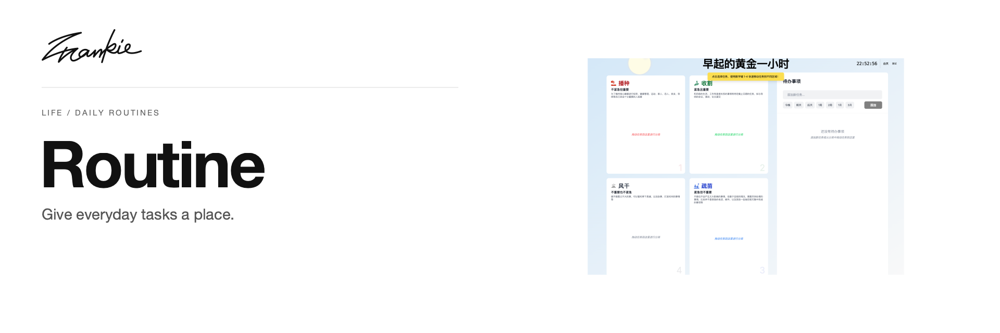

# Frankie Routine

[English](README.md) · [简体中文](README.zh-CN.md)

Give everyday tasks a place, then move them as your priorities change.

[Guide](docs/guide.md) · [Run locally](#run-locally)

## What it does

- Add tasks to a daily to-do list.
- Drag tasks between priority categories and the list.
- Keep task and category preferences in this browser.

## Run locally

```sh
npm ci
npm run dev
```

Open the URL printed by Next.js, normally http://localhost:3000.

## Before you start

Tasks and category preferences are stored in browser localStorage. A different origin has its own state; the app does not automatically synchronize it.

## For developers

```sh
npm run build
```

[Project guide](docs/guide.md) · [Artwork](docs/readme/README.md)

---

Made by [Songhai Fan](https://github.com/SonghaiFan) · A Frankie project
