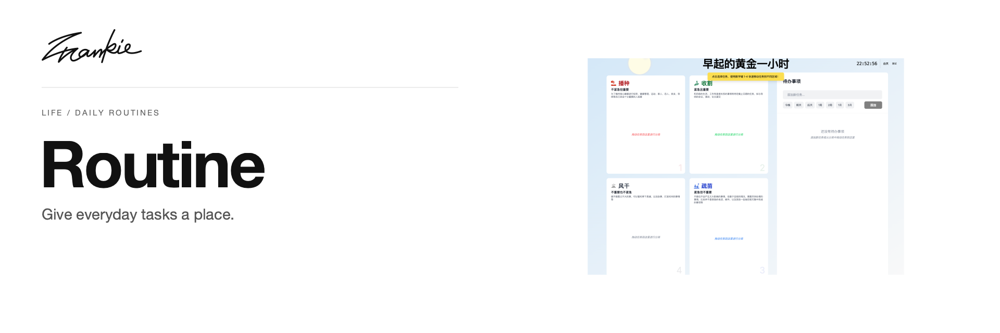

# Frankie Routine

[English](README.md) · [简体中文](README.zh-CN.md)

为日常任务留一个位置，再随优先级变化调整它们。

[项目指南](docs/guide.md) · [本地运行](#本地运行)

## 可以做什么

- 将任务加入每日待办列表。
- 在优先级分类与列表之间拖动任务。
- 在当前浏览器保存任务与分类偏好。

## 本地运行

```sh
npm ci
npm run dev
```

打开 Next.js 输出的地址，通常为 http://localhost:3000。

## 开始之前

任务与分类偏好保存在浏览器 localStorage 中。不同站点地址各自保存状态，应用不会自动同步。

## 开发说明

```sh
npm run build
```

[项目指南](docs/guide.md) · [Banner 维护](docs/readme/README.md)

---

由 [Songhai Fan](https://github.com/SonghaiFan) 制作 · Frankie 系列项目
